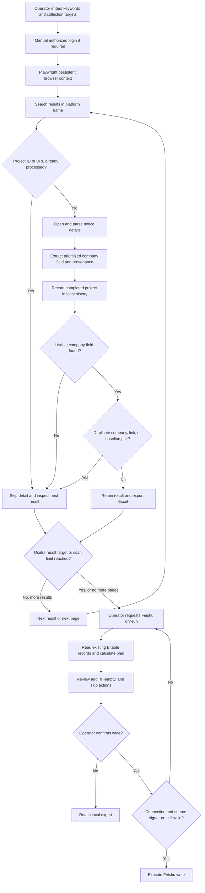
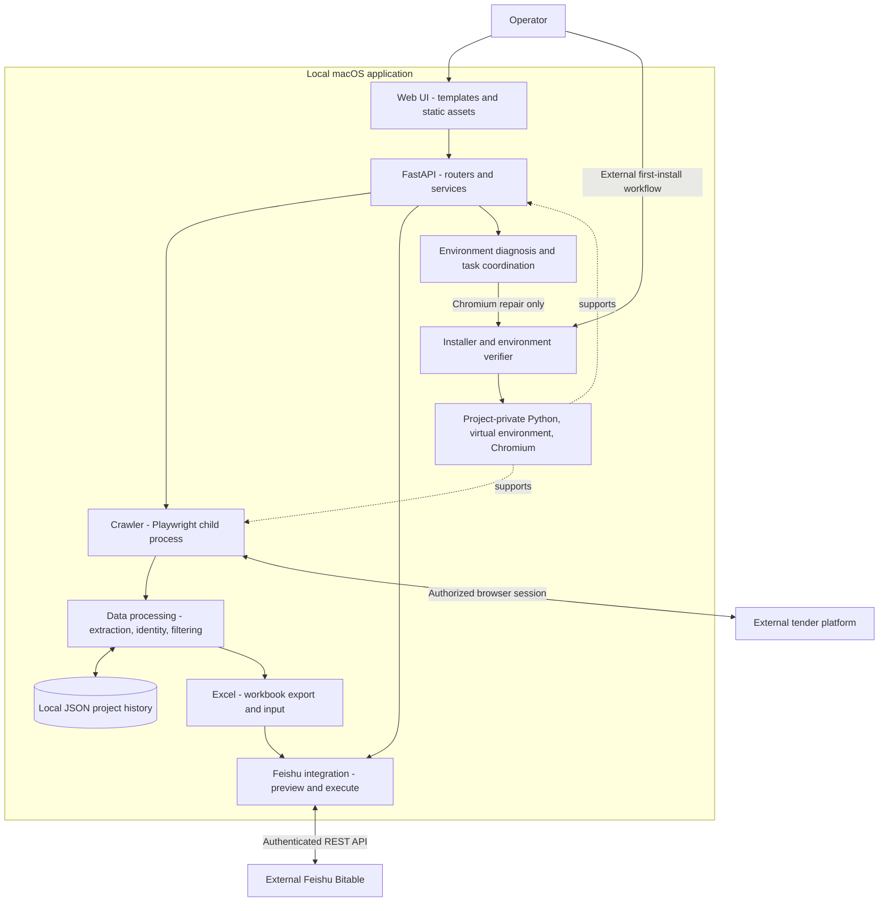

# Architecture

This is a conceptual description of the existing local application. Boxes represent responsibilities visible in its implementation; they do not imply independently deployed services. No source code or internal document is reproduced here.

## Operator workflow

The diagram compresses per-keyword checkpoints and final export into one logical export step. It is not a claim of a distributed transaction across history, workbooks, and Feishu. Recording a project as processed prevents repeat detail inspection; it does not guarantee that its information is final or that a later synchronization succeeded.

## Technical layers

## Responsibilities and boundaries

| Layer | Responsibility | Important limit |
| --- | --- | --- |
| Web UI | Search inputs, progress, history, configuration, preview and confirmation | A local operator surface, not a public customer portal |
| FastAPI | Route requests, coordinate task state, launch child processes, present results | In-process state and filesystem persistence; no distributed queue is claimed |
| Crawler | Navigate dynamic frames, handle result/detail transitions, paginate | Depends on platform layout and operator-authenticated access |
| Data processing | Prioritized field extraction, canonical identity, baseline and company filters | Deterministic matching; no ML-based entity resolution |
| History and Excel | Retain processed-project identities and reviewable exports | History JSON is distinct from result workbooks; no SQL database is claimed |
| Feishu integration | Read table state, calculate plan, add records and fill empty fields | Preview and write are separate calls, not an atomic transaction |
| Environment management | Verify private runtime/dependencies/browser; isolate repair stages | Web repair is Chromium-only; foundational repairs use the external installer |

## Data and trust boundaries

Browser session data belongs to the operator's local profile. Integration settings belong to local configuration. Result workbooks and history belong to the local workflow. None of these artifacts are included in this repository.

The Feishu execution gate checks that the source still matches the previewed signature. It does not freeze external table contents between preview and execution. Company review and an authorized test target remain important before live writes.

Repair coordination rejects conflicts with collection, synchronization, and login activity. This describes the implemented repair boundary, not a claim that every possible task combination has transactional isolation.
