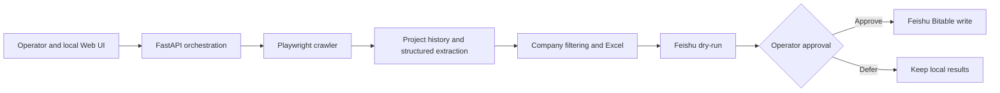

# Channel Lead Collector

**English** | [简体中文](README.zh-CN.md)

### Automated Tender Intelligence & Channel Lead Management

Channel Lead Collector identifies potential channel partners from public tender notices by extracting award-related company information, collecting new projects incrementally, and structuring the results for Excel export and Feishu Bitable synchronization.

**This repository is a documentation-only project showcase for recruiters and interviewers, not a public production service or a runnable distribution.** It explains an existing local macOS application without distributing business source code, operational data, credentials, or internal documents. Public release of this narrative remains subject to the project owner's confidentiality and intellectual-property review.

## Overview

The project connects a practical business workflow with browser automation, a local Web interface, structured data processing, and an external collaboration platform. Its scope extends beyond collecting pages: an operator can define a search, review progress, retain project history, export results, preview a synchronization plan, and explicitly approve a write.

My role centered on defining the workflow, setting product and safety requirements, directing iterative development with Codex, and reviewing acceptance outcomes. AI assisted with implementation, testing, and documentation. See [My Contributions](MY_CONTRIBUTIONS.md) for the attribution boundaries.

## Business Problem

Finding potential partners in tender announcements involves repeated searching, opening details, distinguishing supplier information from purchasing organizations, recording provenance, and checking whether a company is already known. Moving those findings into a shared table introduces another opportunity for duplicates and accidental overwrites.

The engineering objective was to make this process repeatable and reviewable while retaining operator control over authentication and external writes. No measured productivity, revenue, or adoption claims are made here.

## Solution

An operator supplies keywords through a local Web UI. Playwright navigates the tender platform, including embedded search and detail frames. The crawler skips previously processed projects, extracts company fields using an explicit priority order, and filters duplicate results. The application exports a workbook and prepares a Feishu Bitable synchronization plan. The operator reviews that plan before requesting a write.

An award candidate is a potential lead, **not proof of a final contract award**. The selected source field and notice link remain part of the record so that a person can verify the interpretation.

## Key Features

These capabilities are present in the underlying implementation; their validation status is distinguished below.

- Configurable keyword searches, bounded collection, automatic pagination, and progress reporting.
- Persistent local browser context for operator-completed login.
- Historical project deduplication using project IDs, canonical URLs, and fallback identity fields.
- Structured notice parsing, prioritized company-field extraction, and source attribution.
- Incremental collection against an existing result baseline and formatted Excel output.
- Company deduplication and Feishu synchronization that fills empty fields rather than replacing existing populated fields.
- Read-only synchronization preview, source-change detection, and a separate write-confirmation action.
- Local Web configuration of Feishu settings with protected secret handling.
- Project-private Python, locked dependencies, and Chromium deployment on macOS.
- Environment diagnosis, targeted Chromium repair, repeated-install checks, and project-aware Web startup and shutdown.

## System Architecture

The UI and API run locally. Collection is delegated to a Python child process; the Web service presents state and progress. Environment management is a supporting subsystem, not a cloud service. See [Architecture](ARCHITECTURE.md) for the workflow and layer boundaries.

## Technology Stack

| Area | Technology and purpose |
| --- | --- |
| Application | Python 3.11 series |
| Browser automation | Playwright with project-private, visible Chromium |
| Web layer | FastAPI, uvicorn, Jinja2, HTML, CSS, JavaScript |
| Processing and persistence | Python parsing/normalization, JSON history, filesystem-backed artifacts |
| Export | openpyxl for Excel workbooks |
| Integration | Feishu Bitable REST API |
| Deployment | python-build-standalone, virtual environments, per-architecture hash-locked dependencies, macOS command scripts |

This showcase contains documentation only; it does not include dependency locks, executable installers, or application source.

## Engineering Challenges

The most useful decisions concern reliability and boundaries: choosing the correct frame in a dynamic Web application, using stable project identifiers, retaining the origin of extracted company information, separating scan limits from useful-result targets, and requiring a fresh preview before an external write.

Deployment added a second challenge: a colleague should be able to start on a Mac without a preinstalled Python toolchain. The implementation keeps its interpreter, dependencies, and browser in the project directory and checks the actual environment before treating installation state as valid.

See [Technical Highlights](TECHNICAL_HIGHLIGHTS.md) for twelve Problem → Solution → Engineering Value discussions, including the limits of each approach.

## Deployment Design

The underlying Mac application provides a first-install command, a start command, and a stop command. First installation detects macOS and CPU architecture, downloads and verifies a private Python runtime, creates a root virtual environment, installs hash-locked dependencies, and prepares project-private Chromium. Subsequent checks reuse healthy components and repair the affected stage when needed.

The Web interface can repair Chromium when the Python and dependency layers are healthy. A broken interpreter, virtual environment, or dependency layer requires the external installer workflow. A ready environment does not imply that Feishu is configured or that the tender platform is logged in.

The declared minimum is macOS 14. Apple Silicon has recorded RC1 installation and environment acceptance on one newer macOS test configuration. Intel artifacts and dependency selection exist but await hardware validation. This is not evidence of tests on every supported OS or chip generation.

## Safety & Responsible Automation

- Operators must use their own legitimately authorized Jianyu account and comply with applicable access conditions. Login, scanning, and human verification remain manual. The system offers no CAPTCHA or access-control bypass.
- The underlying Web service binds to loopback and is designed as a local operator tool, not a hardened multi-user Internet service.
- Browser login state and Feishu credentials remain local operational material. They are excluded from this showcase.
- Synchronization preview does not write to Feishu, but it may read existing records over the network. Writing is a distinct operator action.
- Company matching is deterministic, not a guarantee of legal-entity identity. Human review is required for ambiguous supplier names and candidate notices.
- Publication of technical descriptions still requires an owner review of disclosure rights. Private access to a project does not establish permission to publish it.

## Project Status

| Area | Evidence and boundary |
| --- | --- |
| Mac installation and runtime | Existing RC1 records report Apple Silicon clean install, hash-locked dependencies, and visible/persistent Chromium smoke checks passed. |
| Web operation and environment repair | Existing acceptance records report local pages/APIs, Chromium repair, repeated startup/stop, and fault-recovery checks passed. |
| Web Feishu configuration | Implemented; an isolated offline test suite and an earlier recorded passing run cover secret handling, file updates, and API restrictions. Tests were not rerun while preparing this showcase. |
| Collection, history, Excel, and synchronization | Implementation inspected; RC1 records contain static regression checks. Authenticated end-to-end collection and live Feishu operations are not established by those records. |
| Live business workflow | Requires manual login, authorized credentials, and a separately approved validation session. No live collection or external writes occurred during showcase preparation. |
| Intel macOS | Implementation matrix prepared; hardware validation pending. |
| Windows | Work in progress with compatibility issues reported by the owner; excluded from this showcase and not validated here. |
| Other platforms | Not validated. No support claim. |

The underlying release is a **Release Candidate**, not a claim of a broadly deployed stable product. See [Validation and Limitations](VALIDATION.md) for how the evidence was assessed.

## Demo

No public screenshots or recordings are included yet. No existing screenshot has been assumed safe to publish, and no synthetic screen is presented as a real run.

- [Screenshot plan](screenshots/README.md)
- [Demo walkthrough and recording checklist](demo/README.md)

Recruiters can review the architecture and engineering explanations immediately. An approved visual walkthrough remains a follow-up item. Cloning this repository provides the case study, not a running collector.

## Future Improvements

- Complete an authorized small end-to-end validation with a disposable integration target.
- Validate Intel hardware and additional macOS versions.
- Develop sanitized browser fixtures and regression tests for layout changes.
- Distinguish candidate and final-award semantics more explicitly in result review.
- Improve entity-name matching with reviewable normalization rules.
- Add reviewed notice-refresh rules instead of assuming processed notices never change.
- Evaluate macOS application packaging and resolve Windows compatibility separately.
- Publish approved visual materials after disclosure review.

These are proposed next steps, not implemented or measured outcomes.
